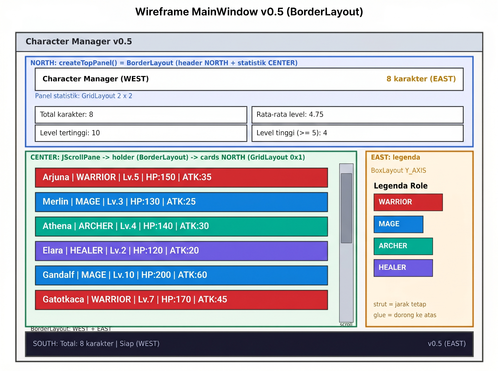
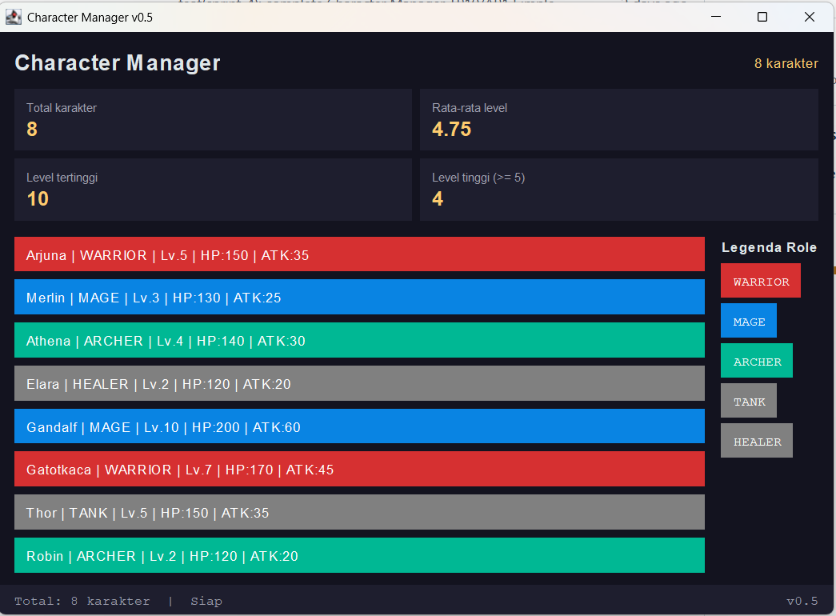
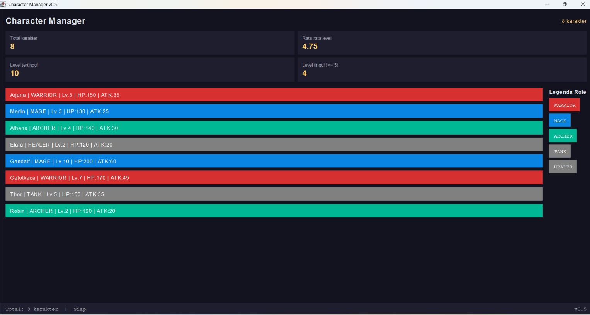
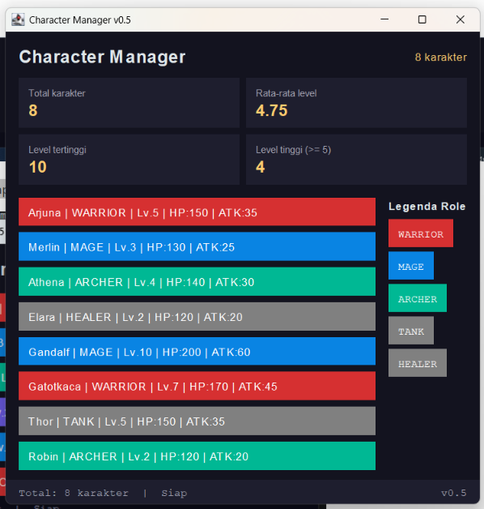

# TP12 — Character Manager Sprint #5
Pada sprint ini MainWindow naik dari v0.4 ke v0.5 dengan tata letak BorderLayout yang tetap rapi saat jendela diubah ukurannya. Empat wilayah terisi: header dan panel statistik (NORTH), daftar karakter berscroll (CENTER), legenda role (EAST), dan bar status (SOUTH). Package model tidak berubah sama sekali.

# Wireframe


# Screenshot


Jendela dilebarkan: 


Jendela dikecilkan sampai scrollbar tampak: 



 # Tabel pengamatan resize (prediksi vs hasil)
 
# Laporan Pengujian Layout MainWindow (Java Swing)

Tabel berikut mendokumentasikan hasil pengujian perilaku komponen antarmuka (*User Interface*) ketika ukuran jendela aplikasi diubah-ubah (*resizing*).

| Aksi | Prediksi (berdasarkan aturan BorderLayout) | Hasil Pengamatan |
| :--- | :--- | :--- |
| **Jendela dilebarkan** | Hanya wilayah **CENTER** yang ikut melebar. Legenda (**EAST**) tetap selebar isinya, sedangkan header dan bar status memanjang mengikuti lebar jendela. | Jendela dapat ditarik melebar ke kanan dan ke kiri, serta dapat di-*maximize*. Daftar kartu di tengah ikut melebar mengisi ruang tambahan, sementara legenda tetap berukuran sama dan header serta bar status memanjang. Hasilnya sesuai prediksi[cite: 3]. |
| **Jendela ditinggikan** | Wilayah **CENTER** bertambah tinggi. Kartu tidak melar karena grid kartu berada di **NORTH** panel `holder`, dan legenda tetap menempel di atas. | Jendela dapat ditarik ke atas dan ke bawah. Area daftar bertambah tinggi, kartu tetap pada tinggi alaminya dengan ruang kosong di bawahnya, dan legenda tetap di bagian atas. Hasilnya sesuai prediksi[cite: 3]. |
| **Tinggi dikecilkan** | Scrollbar muncul atau bertambah panjang di area daftar, sedangkan header dan bar status tetap terlihat. | Ketika tinggi dikecilkan, daftar karakter dapat digeser naik-turun dengan scrollbar sehingga seluruh karakter tetap bisa dilihat, dan header serta bar status tetap tampil. Hasilnya sesuai prediksi[cite: 3]. |
| **Disempitkan sampai batas** | Jendela berhenti mengecil pada ukuran minimum 560 x 380 karena `setMinimumSize`. | Jendela berhenti mengecil pada ukuran minimum dan tidak bisa diperbesar/diperkecil lagi, sehingga tampilan tidak terpotong. Hasilnya sesuai prediksi[cite: 3]. |

Kesimpulannya, tata letak BorderLayout bekerja sesuai rancangan: hanya CENTER yang menyerap perubahan ukuran, area lain mempertahankan ukurannya, dan JScrollPane menjaga seluruh karakter tetap dapat diakses ketika ruang tidak cukup.|

# Struktur panel bersarang
MainWindow memakai BorderLayout dengan empat wilayah, dan setiap wilayah berisi panel yang tersusun bersarang. NORTH berisi panel pembungkus top yang memuat header (judul di kiri, jumlah karakter di kanan) dan panel statistik GridLayout 2x2. CENTER berisi JScrollPane yang membungkus panel holder, dan di NORTH holder ada panel cards ber- GridLayout yang menampung kartu karakter. EAST berisi legenda BoxLayout vertikal yang diturunkan dari CharacterType.values(), dan SOUTH berisi bar status dengan teks di kiri dan versi di kanan.
```text
MainWindow (JFrame, BorderLayout)
├── NORTH  : top (JPanel, BorderLayout)
│   ├── NORTH  : header (BorderLayout)  judul WEST, jumlah EAST
│   └── CENTER : stats (GridLayout 2x2) empat sel statistik
├── CENTER : JScrollPane
│   └── holder (BorderLayout)
│       └── NORTH : cards (GridLayout 0x1) -> kartu JLabel
├── EAST   : legend (BoxLayout Y_AXIS) -> strut, chip per role, glue
└── SOUTH  : status (BorderLayout)  teks WEST, versi EAST
```

# panel tambahan: statistik GridLayout 2x2
Panel statistik (total karakter, rata-rata level, level tertinggi, jumlah karakter level tinggi) saya taruh di bawah header. Saya memilih GridLayout 2x2 karena keempat statistik setara dan sebaiknya berukuran seragam, serta tetap tersusun dua kolom saat jendela dilebarkan. Layout yang saya tolak:

FlowLayout: sel berukuran sesuai isi (tidak seragam), dan bisa pindah baris sendiri ketika jendela menyempit sehingga susunan 2x2 tidak stabil.
BoxLayout: hanya menyusun pada satu sumbu, sehingga 2x2 membutuhkan panel bersarang tambahan.
GridBagLayout: terlalu rumit untuk empat sel yang ukurannya sama.
Bar status awalnya memakai FlowLayout, lalu saya ganti ke BorderLayout agar teks status menempel kiri dan versi menempel kanan, karena FlowLayout tidak bisa menempelkan elemen ke sisi kanan.

Catatan: statistik dihitung di MainWindow dari list yang diterima. Idealnya perhitungan seperti itu berada di Model atau Controller, dan ini saya catat sebagai perbaikan untuk sprint berikutnya.
# Bukti git diff: package model tidak berubah
 git diff HEAD~1 HEAD --stat -- src/com/unpri/charactermanager/model
 Output perintah di atas kosong, artinya tidak ada perubahan di Character.java, CharacterType.java, maupun CharacterManager.java.

## Struktur folder
```text
 CharacterManager/
├── src/
│   ├── com/
│   │   └── unpri/
│   │       └── charactermanager/
│   │           ├── model/
│   │           │   ├── Character.java
│   │           │   ├── CharacterManager.java
│   │           │   └── CharacterType.java
│   │           └── view/
│   │               ├── AppTheme.java
│   │               └── MainWindow.java
│   └── Main.java
├── output-tp5.png
├── output.png
├── README.MD
├── tp8-sebelum.png
├── tp8-sesudah.png
├── tp10-sebelum-v03.png
├── tp10-sesudah-v04.png
├── tp12-awal.png
├── tp12-kecil.png
├── tp12-lebar.png
└── tp12-wireframe.jpg.png
```
# Analisis Bagian D TP12 (Google Docs)
https://docs.google.com/document/d/1ePFxjcglgycqkUmzV-QMRBnaMeipkX0f/edit?usp=drive_link&ouid=117130834806065707688&rtpof=true&sd=true